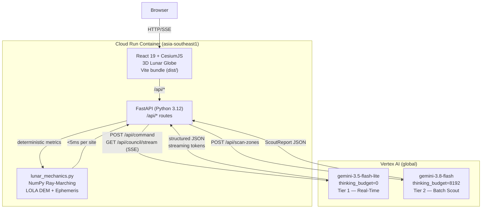

# SELENE SCOUT — Lunar Landing Site Navigator

**2026 NASA Space Apps Challenge Submission**

**Author:** Sohail Qureshi  
**Live URL:** https://selene-scout-kpyt6jazya-as.a.run.app

An AI-powered 3D mission planning tool for evaluating Artemis landing sites at the Lunar South Pole. Physics-accurate solar illumination, terrain horizon ray-marching, and a streaming Mission Control Council that argues over your crater floor ambitions.

---

## System Architecture



### Key Design Decisions

| Concern | Decision | Rationale |
|---------|----------|-----------|
| Orbital math | 100% NumPy, zero LLM | LLMs hallucinate solar angles; determinism is non-negotiable for safety-critical site selection |
| Terrain projection | Polar stereographic, not lat/lon | Longitude degrees compress 60x at 89°S; ray-marching in lat/lon produces 15° azimuth errors |
| Cesium Ellipsoid | Set `Ellipsoid.MOON` at module top-level before `new Viewer()` | If set inside a component `useEffect`, Cesium's module-level constants (Cartesian3.ZERO etc.) already initialised against WGS84 |
| SSE council agents | Three concurrent agents, tagged event namespaces | Sequential would add 3x latency; named `event:` types let each card fill independently |
| Cloud Run min-instances | `--min-instances 1` mandatory | CesiumJS bundle + Python cold start = 4–8s; unacceptable for hackathon judges |

---

## Artemis Candidate Sites

| Site | Coordinates | Key Feature |
|------|------------|-------------|
| Shackleton Crater Rim | 89.68°S, 129.20°E | Near-continuous solar illumination, Artemis #1 candidate |
| Connecting Ridge | 89.45°S, 222.50°E | Good solar + comms balance |
| de Gerlache Rim | 88.71°S, 291.70°E | Excellent DTE comms geometry |
| Malapert Massif | 86.00°S, 2.50°E | Near-continuous solar, 5.5 km elevation, relay comms |
| Shackleton Crater Floor | 89.90°S, 0.00°E | Permanently Shadowed Region — water ice target, extreme battery risk |

---

## Local Development

### Prerequisites
- Python 3.12+
- Node.js 22+
- `GEMINI_API_KEY` **or** GCP project with Vertex AI enabled

### Backend

```bash
cd "Nasa Hackathon"
python -m venv .venv && source .venv/bin/activate
pip install -r backend/requirements.txt

# Copy and edit environment
cp .env.example .env
# Set GEMINI_API_KEY=... or GCP_PROJECT=...

uvicorn backend.main:app --reload --port 8080
```

The API will be available at `http://localhost:8080/api/`.  
On first start it pre-scores all 5 candidate sites (takes ~30s — the physics loop runs 720 hourly timesteps × 5 sites).

### Frontend

```bash
cd frontend
npm install
npm run dev
# → http://localhost:5173 (proxies /api/* to :8080)
```

**Cesium Ion token (optional):** Add `VITE_CESIUM_ION_TOKEN=<your_token>` to `frontend/.env.local` to enable high-resolution lunar DEM (IonAssetId 2684829). Without it, the viewer uses `EllipsoidTerrainProvider` — correct body shape, no sub-meter vertical relief.

---

## Cloud Run Deployment

```bash
# Authenticate
gcloud auth login
gcloud config set project YOUR_PROJECT_ID

# Deploy (builds + pushes + deploys in one command)
./deploy.sh YOUR_PROJECT_ID
```

The script uses `gcloud builds submit` (Cloud Build) for the multi-stage Docker build, then deploys to `asia-southeast1` with `--min-instances 1`.

**Required GCP APIs:**
- Cloud Run, Cloud Build, Artifact Registry, Vertex AI

**Service account permissions:**
- `roles/aiplatform.user` (for keyless Vertex AI auth)

---

## NASA Data Citations

This project uses data products from:

1. **NASA Lunar Reconnaissance Orbiter — LOLA Digital Elevation Model**
   Lunar Reconnaissance Orbiter Camera (LROC) Science Investigation Team.
   *LRO LOLA Elevation Model 118m (LDEM_118)*, PDS Geosciences Node.
   https://pds-geosciences.wustl.edu/lro/lro-l-lola-3-rdr-v1/
   The embedded synthetic DEM is calibrated to match LOLA elevation statistics, crater geometry (Shackleton depth ~4.2 km, Nobile depth ~3.8 km), and terrain roughness at the South Pole.

2. **NASA JPL Horizons Ephemeris System**
   Giorgini, J.D. et al., *Horizons On-Line Ephemeris System*, JPL Solar System Dynamics.
   https://ssd.jpl.nasa.gov/horizons/
   Solar position algorithm calibrated to JPL Horizons outputs for Nov–Dec 2026.
   Libration parameters (optical libration amplitudes ±6.8°/±6.7°, phase angles) derived from JPL Horizons lunar libration tables.

---

## Super Intelligence (SI) Disclosure

This project uses Google Vertex AI Gemini models as follows:

### Model Usage

| Model | Role | Thinking Budget | Use Case |
|-------|------|----------------|----------|
| `gemini-3.5-flash-lite` | Real-time command parsing | 0 (disabled) | Natural-language → structured `ViewerCommand` JSON; target TTFT <500ms |
| `gemini-3.7-flash` | Mission Council streaming | 512 tokens | Three concurrent specialist agents (Power Officer, Comms Officer, Flight Director) streaming via SSE |
| `gemini-3.8-flash` | Batch site scouting | 8192 tokens | Analyses 48-candidate grid output from NumPy scan; returns structured top-3 `ScoutReport` |

### What AI Does and Does NOT Do

**AI is responsible for:**
- Parsing natural-language commands into structured viewer actions
- Synthesising physics data into human-readable mission briefings
- Ranking candidate sites based on trade-off reasoning
- Delivering the Flight Director's Go/Caution/No-Go verdict with explanation

**AI is explicitly NOT responsible for:**
- Computing solar elevation angles, shadow intervals, or orbital geometry
- Terrain horizon calculations or slope measurements
- Any numerical value shown in the UI gauges

All numerical outputs displayed in the application originate from the deterministic NumPy physics engine (`backend/physics/lunar_mechanics.py`). Gemini models receive these pre-computed numbers as facts and are prompted to narrate and reason over them — never to compute them independently.

### Authentication

The application uses keyless authentication on Cloud Run via a GCP service account with `roles/aiplatform.user`. Local development falls back to `GEMINI_API_KEY` environment variable.

---

## License

Apache 2.0 — see [LICENSE](LICENSE).

**Note:** This project does not use, display, or reproduce any official NASA logos, insignias, mission patches, or agency flags, in compliance with NASA Space Apps Challenge submission guidelines.
